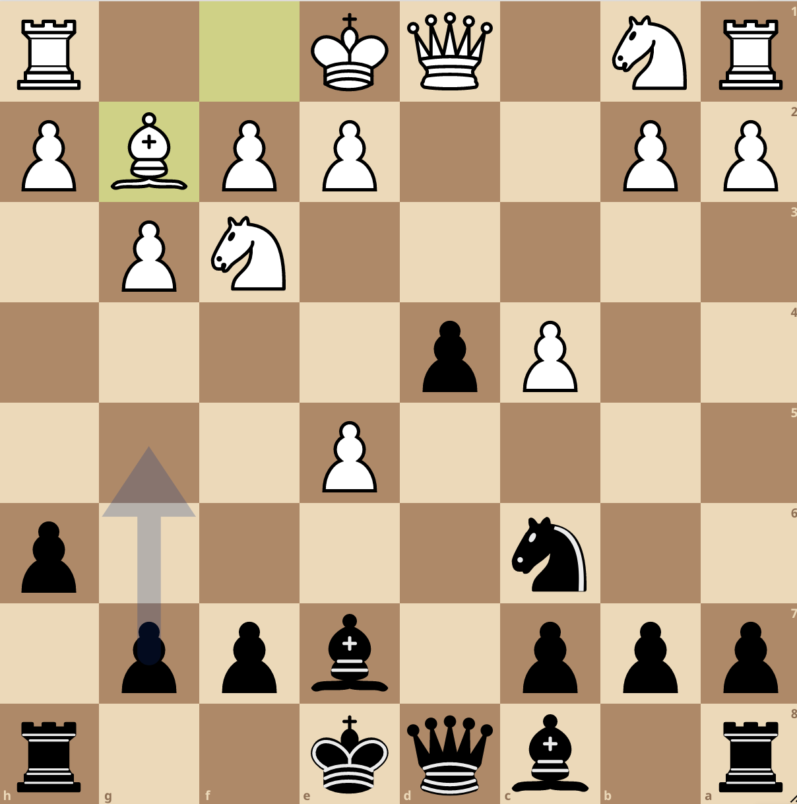
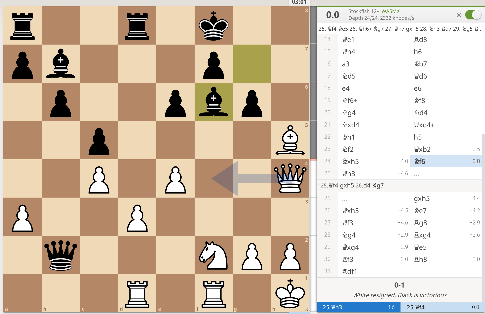
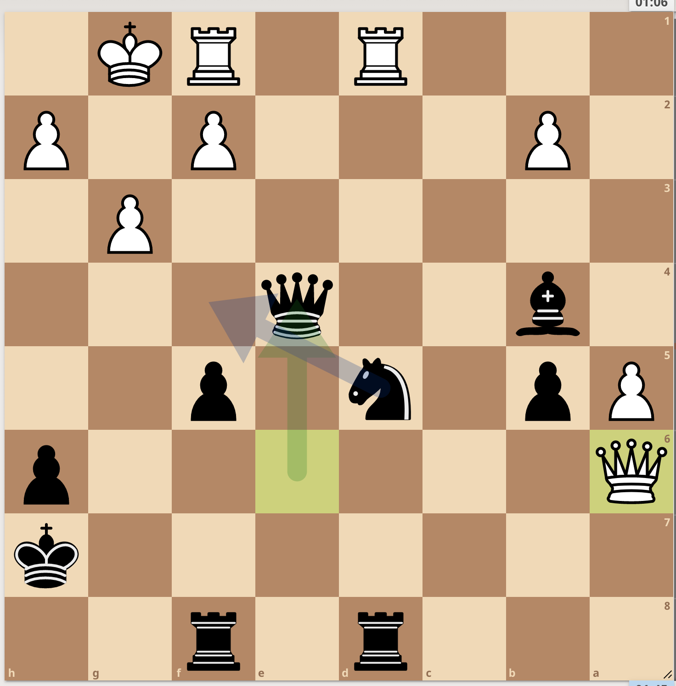
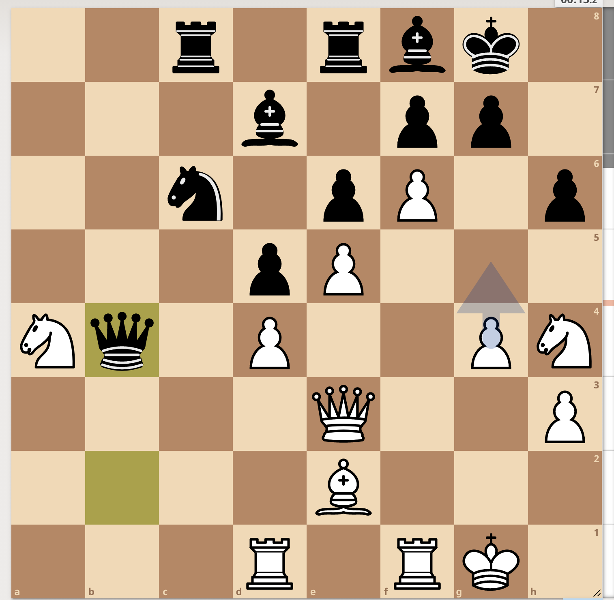
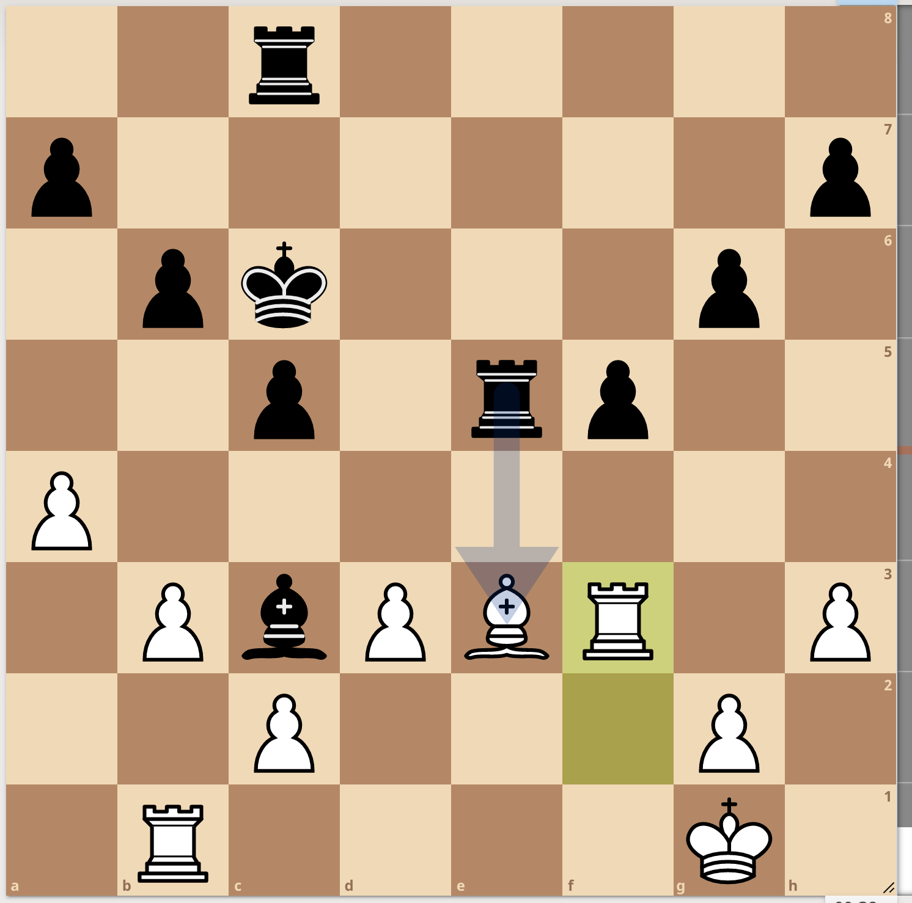
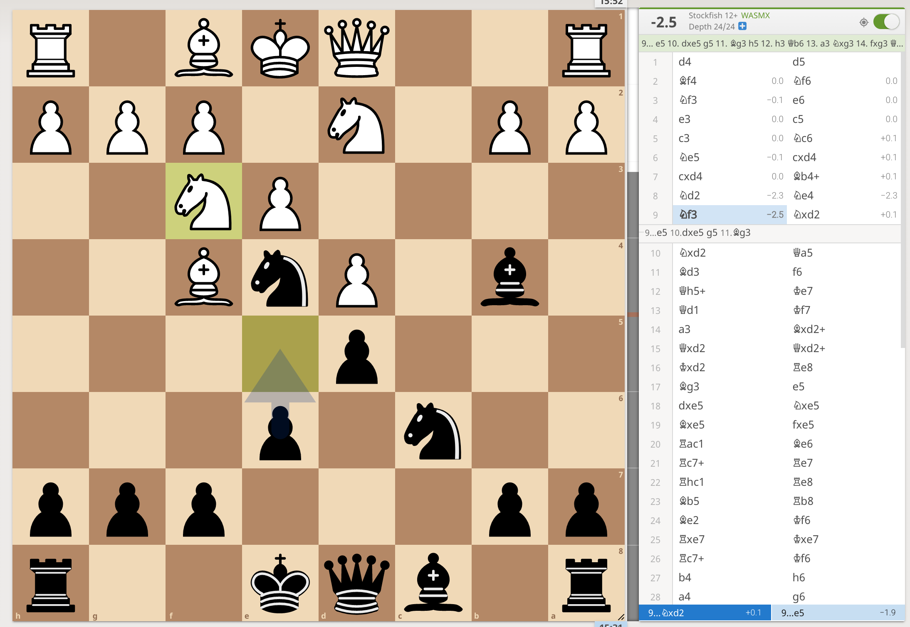
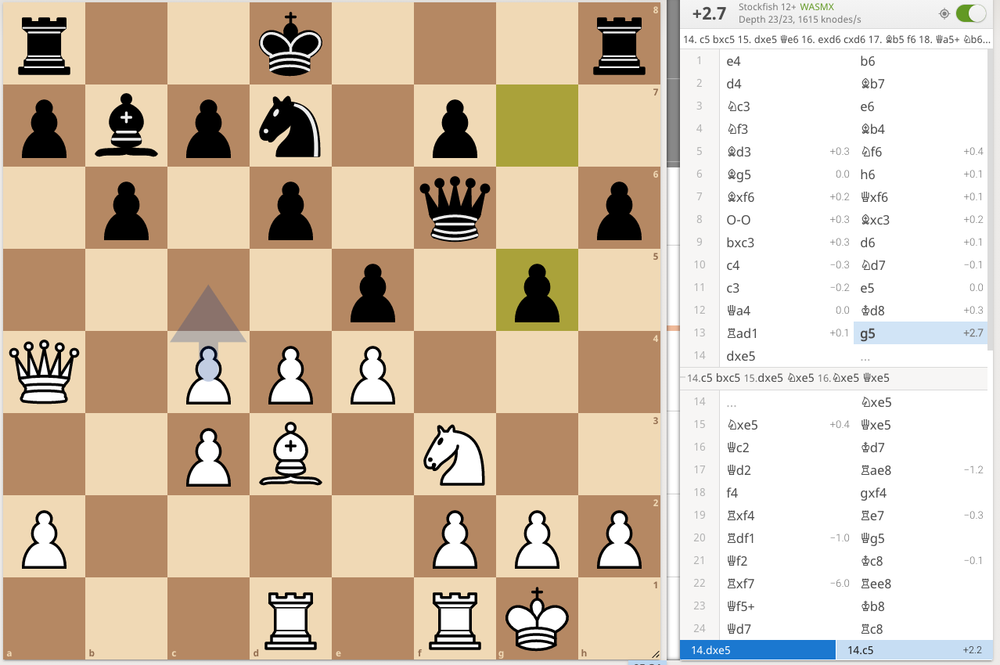
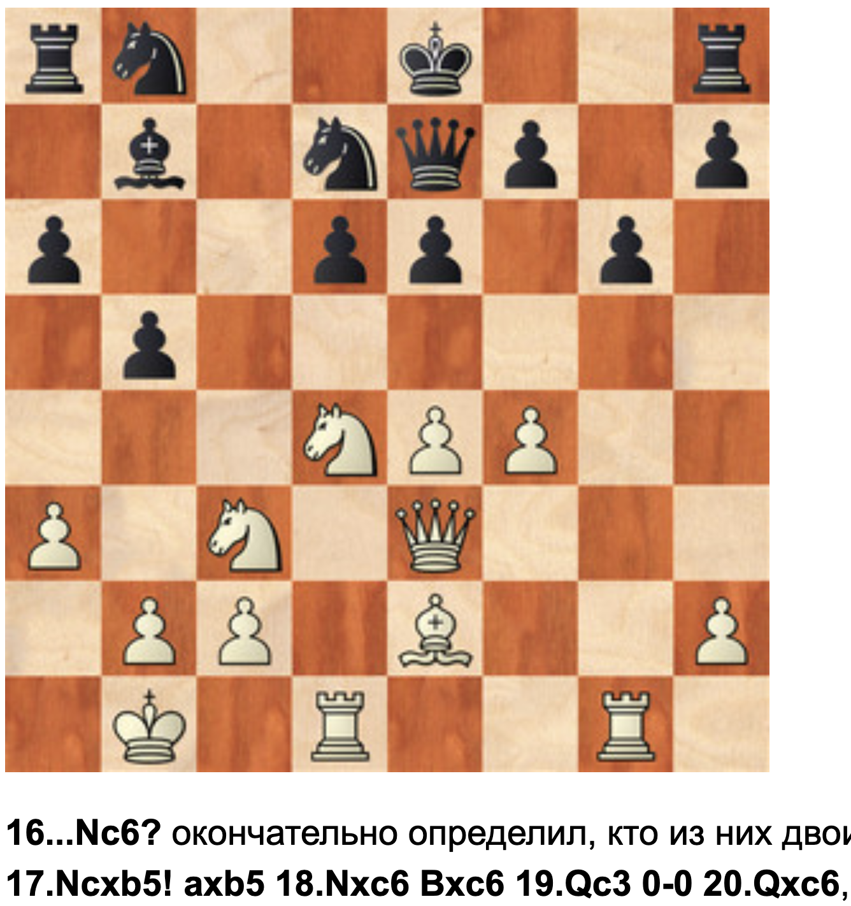
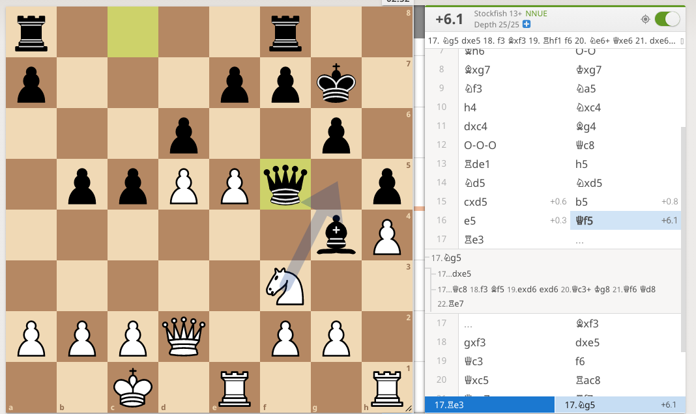
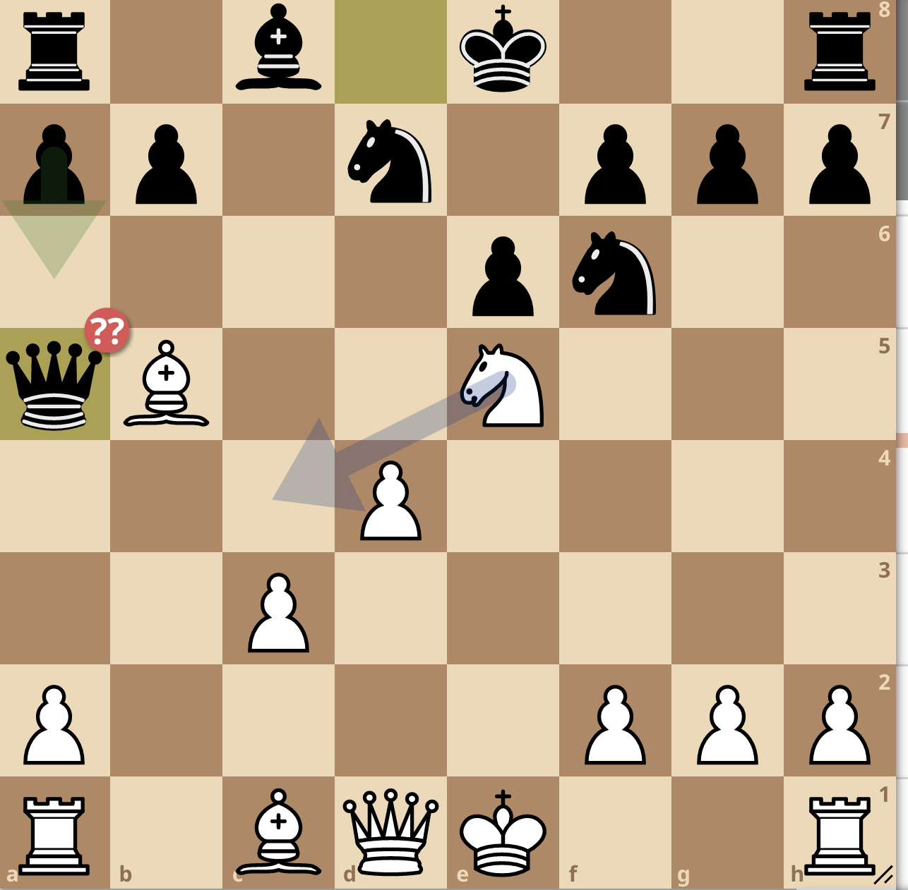

## Chess

  https://healeycodes.com/building-my-own-chess-engine/ Python
  
  https://news.ycombinator.com/item?id=25446399
  
  https://lichess.org/@/lu1961/search?perf=3 My 15+15 games 
 
  https://lichess.org/@/lu1961/search?perf=6">My 10+0 games 
 
  https://blunders.ai/openings/

## Chess Positions

<https://lichess.org/game/mkwL4j1M/black>

<https://lichess.org/game/Uds5AIGC/white#75>

PGN

1. e4 c6 2. d4 d5 3. e5 c5 4. c3 Nc6 5. Nf3 cxd4 6. cxd4 Bg4 7. Be2 e6 8. a3 Nge7 9. Nc3 Nf5 10. Qa4 Bxf3 11. Bxf3 Nxd4 12. Bf4 Nxf3+ 13. gxf3 g6 14. Nb5 Qa5+ 15. Qxa5 Nxa5 16. Nc7+ Kd7 17. Nxa8 Be7 18. Nc7 Kxc7 19. Rc1+ Kd7 20. Be3 Nc4 21. Rc2 Nxe5 22. Ke2 a6 23. Bd4 f6 24. Rhc1 Nc6 25. Bb6 Bd6 26. h3 Be5 27. b4 Ra8 28. Kf1 Bd6 29. Kg2 e5 30. Rd1 d4 31. Kf1 Nd8 32. Rdc1 Ne6 33. h4 h5 34. Ke2 g5 35. Rh1 Rh8 36. Rcc1 g4 37. fxg4 hxg4 38. Rcg1 f5 39. f3 gxf3+ 40. Kxf3 e4+ 41. Ke2 d3+ 42. Kd1 Be5 43. Re1 Rc8 44. Rhf1 d2 45. Re2 Rc1+ 46. Kxd2 Rxf1 

